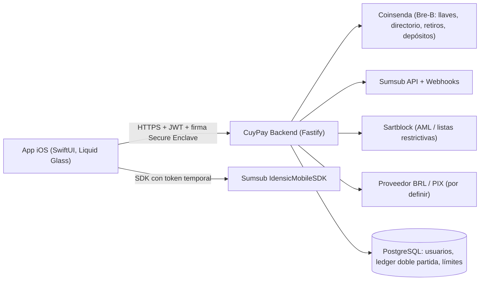
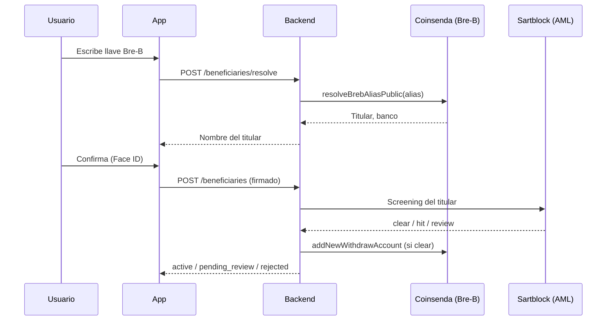

# Arquitectura CuyPay iOS

## Principios
1. **La app no guarda secretos de terceros.** Coinsenda (clave RSA), Sumsub y Sartblock solo en el backend.
2. **Face ID = clave criptográfica**, no un simple "sí/no": la clave P-256 vive en el Secure Enclave con
   `biometryCurrentSet`; sin Face ID no hay firma, y sin firma el backend no mueve dinero.
3. **Ledger de doble partida** en el backend; los bolsillos COP/BRL son cuentas contables. Retenciones para envíos en curso e idempotencia en toda operación de dinero.
4. **Proveedores detrás de interfaces** (mock / live) para cambiar de socio BRL o de AML sin tocar la app.

## Flujos clave

### Inscripción de beneficiario

### Conversión COP → BRL
App pide cotización (`/fx/quotes`, 30 s) → usuario confirma con Face ID → backend valida límites y saldo →
débito COP / crédito BRL en el ledger → ejecución con el proveedor BRL.

### Envío Bre-B
Preview (comisión + límites) → Face ID → backend retiene fondos → `addNewWithdrawPublic` → `addUpdateWithdraw(confirmed)` →
completa o revierte la retención.

## Límites
Configurables por nivel (`basic`, `full`) y operación (`transfer_out`, `conversion`, `deposit_in`) en periodos
diario / mensual / anual calendario de Bogotá, en COP equivalente.

> [!IMPORTANT]
> Los montos por defecto son de ejemplo. Deben ajustarse a la política SARLAFT de CuyPay y a la regulación aplicable
> (Superfinanciera / UIAF en Colombia; Banco Central do Brasil para el lanzamiento en Brasil).

## Pendientes para producción
- Persistencia PostgreSQL (esquema en `backend/db/schema.sql`), KMS/HSM para la clave RSA de Coinsenda y el secreto JWT.
- Confirmar payloads exactos de Coinsenda (marcados `TODO(coinsenda)`), especificación de la API de Sartblock y el socio BRL/PIX.
- Reportes regulatorios (ROS/UIAF), monitoreo transaccional, App Attest / DeviceCheck, certificate pinning.
