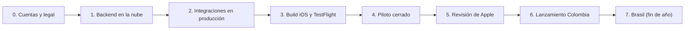

# Guía de despliegue y lanzamiento — CuyPay iOS

Ruta completa desde el repositorio hasta la App Store en Colombia, y luego Brasil.
Marca: ✅ = ya está en el repo · 🧑‍💼 = lo hace CuyPay (negocio / legal) · 🛠️ = técnico pendiente.



---

## Datos de la cuenta Apple

| Dato | Valor | Estado |
|---|---|---|
| Team ID | `YRFDF3T7CQ` | ✅ Configurado en `ios/project.yml` y Fastlane |
| Entidad legal | **XATECH SERVICES S.A.S.** (marca CuyPay) | ✅ |
| D-U-N-S | `963698649` (a nombre de XATECH SERVICES S A S) | ✅ Asignado |
| Tipo de entidad | Individual → **Organization** | ⏳ Conversión por solicitar a Apple |
| Bundle ID | `com.cuypay.app` | ⏳ Por registrar |
| API Key App Store Connect | Key ID `Y4G39PY7CG` · Issuer `a2afdadf-5348-49b3-ae25-ddfc0a930044` · rol Gestor de apps | ✅ Creada |
| Repo de certificados | `bdortiz16/cuypay-certificates` (privado) | ✅ Creado |

## 0. Cuentas y requisitos legales 🧑‍💼 (empezar YA, es lo más lento)

| # | Tarea | Notas |
|---|---|---|
| 0.1 | **Apple Developer Program como Organización** (USD 99/año) | A nombre de la empresa (no persona natural). Exige **número D-U-N-S** (gratis, tarda 1–2 semanas) y un sitio web con el dominio de la empresa. Apple exige que las apps de servicios financieros las publique **la entidad legal que presta el servicio** (guía 5.1.1(ix)). |
| 0.2 | **Dominio y correo**: `cuypay.com`, `api.cuypay.com` | El correo del Apple ID debe ser del dominio de la empresa. |
| 0.3 | **Política de privacidad y Términos y condiciones** publicados en la web | Obligatorios para la App Store. Deben cubrir la **Ley 1581 de 2012 (Habeas Data)**, el tratamiento biométrico/KYC con Sumsub y la transferencia internacional de datos. Registro de bases de datos en el **RNBD de la SIC**. |
| 0.4 | **Marco regulatorio Colombia** | Confirmar con abogado/Coinsenda bajo qué figura opera CuyPay (Bre-B requiere participar a través de una entidad vigilada; aquí es Coinsenda). Manual **SARLAFT**, oficial de cumplimiento, reportes a la **UIAF** (ROS, transacciones en efectivo si aplica). |
| 0.5 | **Contratos** con Coinsenda (producción), **Sumsub** (plan productivo) y **Sartblock** (AML) | Pedir a Sartblock su documentación de API. |
| 0.6 | **Socio BRL / PIX** | Para Brasil, el cambio COP→BRL lo debe liquidar una institución autorizada por el **Banco Central do Brasil**. Definirlo antes de abrir el bolsillo BRL al público. |
| 0.7 | **Logo vectorial** de Zarta Studio | Hoy hay una versión vectorizada provisional en `docs/brand/`. |

## 1. Backend en la nube 🛠️

**Ya está:** ✅ `backend/Dockerfile` · ✅ CI que corre pruebas y construye la imagen (`.github/workflows/backend.yml`).

Arquitectura recomendada (AWS; equivalente en Google Cloud: Cloud Run + Cloud SQL + Secret Manager):

| Pieza | Servicio sugerido |
|---|---|
| Contenedores | ECS Fargate (2+ tareas, multi-AZ) detrás de un ALB con HTTPS |
| Base de datos | RDS PostgreSQL (multi-AZ, cifrado, backups diarios, PITR) |
| Secretos | Secrets Manager + **KMS** (clave RSA de Coinsenda, secretos de Sumsub/Sartblock y JWT) |
| Red / seguridad | WAF, tráfico de salida con IP fija (NAT) para listas blancas de proveedores |
| Observabilidad | CloudWatch / Datadog, alertas de errores 5xx, latencia y fallas de proveedores |
| DNS / TLS | Route 53 + ACM → `api.cuypay.com` |

Tareas técnicas antes de producción:
1. 🛠️ **Persistencia PostgreSQL**: implementar los repositorios con el esquema `backend/db/schema.sql` (hoy están en memoria).
2. 🛠️ Variables `NODE_ENV=production`, `PROVIDERS_MODE=live`, `HOST=0.0.0.0`; las rutas `/v1/dev/*` quedan apagadas en producción.
3. 🛠️ **Bloqueo distribuido** para el job que consulta depósitos (una sola instancia a la vez).
4. 🛠️ **Cuenta de revisión para Apple** (ver §5): usuario con KYC aprobado y saldo de prueba aislado.
5. 🛠️ Ambientes separados: `staging` (Coinsenda `bitsenda.com`, Sumsub sandbox) y `production`.

## 2. Integraciones en producción 🛠️ + 🧑‍💼

| Proveedor | Qué configurar |
|---|---|
| **Coinsenda** | Generar el par RSA en el servidor, registrar la **clave pública** en *Perfil → API Public Key* de la cuenta productiva, obtener `COINSENDA_BREB_DEPOSIT_ACCOUNT_ID` y `COINSENDA_COP_ACCOUNT_ID`. Probar en staging y cerrar los `TODO(coinsenda)` del adaptador. |
| **Sumsub** | Crear el *level* de KYC productivo (documento + selfie/liveness), App Token y Secret, y el webhook `https://api.cuypay.com/v1/webhooks/sumsub` con su secreto. |
| **Sartblock** | URL y API key; completar el adaptador (`TODO(sartblock)`); definir con cumplimiento qué hacer con "revisión". |
| **Socio BRL** | Implementar el adaptador `BrlLiquidityProvider` real. |
| **SMS OTP** | Proveedor real (Twilio Verify, Infobip, etc.) en lugar del OTP de prueba. |

## 3. Build iOS y TestFlight 🛠️

**Ya está:**
- ✅ Proyecto XcodeGen (`ios/project.yml`) con configuraciones Dev/Prod, ícono y colores.
- ✅ **CI iOS** (`.github/workflows/ios.yml`): compila y corre pruebas en una Mac de GitHub en cada cambio.
- ✅ **Fastlane** (`ios/fastlane/Fastfile`): carriles `tests`, `beta` (TestFlight) y `release` (enviar a revisión).
- ✅ Workflow manual **iOS → TestFlight** (`.github/workflows/ios-testflight.yml`).

Pasos (una sola vez):
1. En **App Store Connect** → *Apps* → **+** → nueva app: nombre **CuyPay**, idioma principal Español, bundle ID `com.cuypay.app` (créalo antes en *Certificates, Identifiers & Profiles*).
2. *Users and Access → Integrations →* **App Store Connect API Key** con rol *App Manager*. Guarda Key ID, Issuer ID y el archivo `.p8`.
3. Crea un **repo privado vacío** para certificados (p. ej. `cuypay-certificates`) y ejecuta una vez en una Mac:
   ```bash
   cd ios && bundle install && bundle exec fastlane match appstore
   ```
4. En GitHub → *Settings → Secrets and variables → Actions*, agrega solo 3 secretos:
   `ASC_KEY_CONTENT` (texto del `.p8`), `MATCH_PASSWORD` (contraseña inventada) y `MATCH_GIT_BASIC_AUTHORIZATION` (base64 de `usuario:token` con acceso a `cuypay-certificates`). El Team ID, el Key ID y el Issuer ID ya vienen configurados.
5. Primera vez: *Actions → iOS → TestFlight → Run workflow* con **"crear certificados"** marcado (no hace falta el paso 3 en una Mac). Las siguientes veces, sin marcar.

## 4. Piloto cerrado (TestFlight) 🧑‍💼

- Testers internos (hasta 100, sin revisión) → equipo CuyPay.
- Testers externos (hasta 10.000, requiere revisión ligera) → 20–50 clientes reales con **límites bajos**.
- Validar con dinero real y montos pequeños: crear llave Bre-B, recibir, inscribir beneficiario, enviar, convertir.
- Revisar: tasas de aprobación de KYC, falsos positivos de AML, tiempos de Bre-B y conciliación diaria del ledger contra Coinsenda.

## 5. Revisión de Apple 🧑‍💼 + 🛠️

Ficha de la App Store:
- **Categoría:** Finanzas. **Disponibilidad:** solo Colombia al inicio.
- **Capturas** obligatorias de iPhone 6.9" (1320 × 2868), por ejemplo: Inicio, Convertir, Enviar, Recibir y Beneficiarios.
- Texto, palabras clave, URL de soporte, **URL de política de privacidad**.
- **Etiquetas de privacidad** (App Privacy): información de contacto (nombre, correo, teléfono), identificadores (ID de usuario), **información financiera** (saldos, transacciones), **documento de identidad y fotos del rostro** (KYC con Sumsub), todo **vinculado al usuario** y **sin rastreo**. Face ID **no** sale del iPhone (la app solo recibe "sí/no" y una firma).
- **Cifrado:** la app solo usa cifrado estándar del sistema (HTTPS, CryptoKit) → `ITSAppUsesNonExemptEncryption = NO` (ya configurado).
- **Notas para el revisor:** credenciales de la **cuenta de revisión** (KYC preaprobado, saldo de prueba), explicación de que Bre-B es el sistema de pagos inmediatos del Banco de la República y evidencia de la licencia o alianza (Coinsenda).

> [!WARNING]
> Las causas de rechazo más comunes en fintech son: publicar desde una cuenta personal, no dar una cuenta demo funcional, no tener la política de privacidad, y no mostrar la licencia o alianza regulatoria.

## 6. Lanzamiento Colombia 🧑‍💼

- Publicación **manual** después de la aprobación (el carril `release` no publica solo), idealmente con **lanzamiento por fases** en 7 días.
- Monitoreo en vivo: errores, KYC, AML, envíos fallidos, saldo de la cuenta Coinsenda frente al ledger.
- Soporte: canal de atención y procedimiento de reclamos (exigido por el regulador).

## 7. Brasil (fin de año) 🛠️ + 🧑‍💼

- Socio BRL/PIX autorizado por el BCB en producción; recibir y enviar por **PIX** desde el bolsillo BRL.
- KYC brasileño (CPF) en Sumsub, **LGPD**, límites propios para Brasil.
- Completar las traducciones pt-BR (`Localizable.xcstrings`; hoy 91 de 240 textos) y abrir la disponibilidad de la App Store en Brasil.

---

## Calendario de referencia

| Semana | Hito |
|---|---|
| 1–2 | D-U-N-S, cuenta Apple Organización, contratos, política de privacidad · CI en verde |
| 2–5 | Postgres, staging con Coinsenda/Sumsub/Sartblock reales, OTP real |
| 5–6 | Producción en la nube, auditoría de seguridad / pentest |
| 6–8 | TestFlight interno → piloto externo con límites bajos |
| 8–9 | Envío a revisión de Apple (1–7 días; en fintech pueden pedir aclaraciones) |
| 9–10 | Lanzamiento por fases en Colombia |
| Q4 | Brasil |
